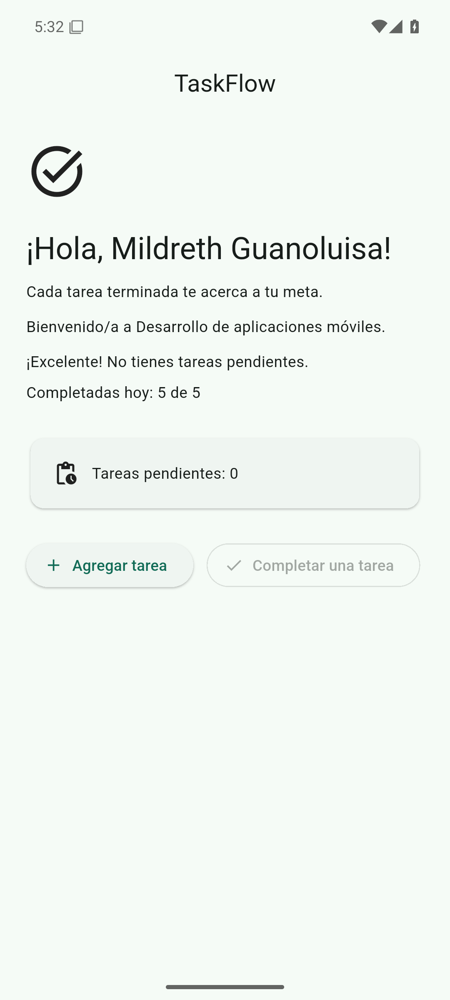
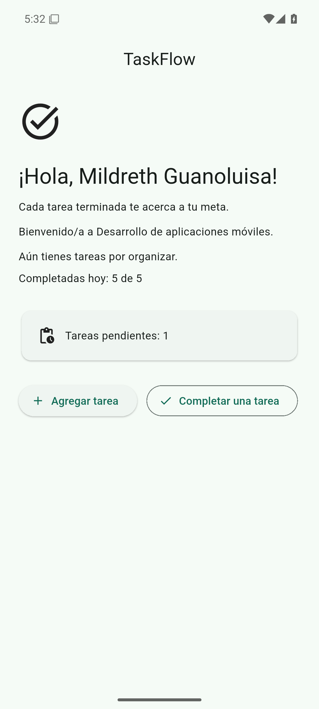

# Evidencias de la sesión 2

Capturas y un video reales de TaskFlow en un emulador Android remoto. No son fotos de un teléfono físico ni dibujos de la pantalla.

**Estudiante:** Mildreth Guanoluisa

## Entorno de la captura

Datos registrados con el paquete de evidencias del 7 de noviembre de 2026:

- Flutter 3.47.9 (Dart 3.13.7). Ese Dart cumple el límite `sdk: ^3.13.7` de `pubspec.yaml`.
- Android 15, API 35. Imagen `system-images;android-35;google_apis;x86_64`.
- AVD `taskflow_api35`, 1080×2400, 420 dpi, 2048 MB de RAM.
- Emulador remoto y headless (`-no-window -no-audio -no-boot-anim -gpu swiftshader_indirect -accel on`), dispositivo `emulator-5554`.
- Android Emulator 37.2.13, sin Android Studio.
- Paquete `com.example.taskflow`, actividad `.MainActivity`. Es el `applicationId` y la actividad de este repositorio.
- APK de depuración (`flutter build apk --debug`) instalada en el emulador. Las imágenes se guardaron con `adb exec-out screencap -p`.
- El video `sesion-02-ejecucion.mp4` es de ese mismo emulador remoto (Android 15, API 35, AVD `taskflow_api35`, Flutter 3.47.9), no de un teléfono. El contenedor es H.264, 1080×2400, 24 fps, 21,8 s (21,83 s) y no tiene audio. El reloj de la barra marca 7:06.

## Código fuente

Las imágenes y el video muestran el panel de `lib/main.dart` del commit de la app:

`4ab8ca32c47b9f3623d21476ee71590733c643f8`

Mensaje de ese commit: `feat: agregar estado de tareas`. Ese archivo sigue igual en `main` (`5291582d3146ab80f8a2ac7414dd0aed5a434b9e`). El video no cambia el código de la app, las pruebas, `pubspec.yaml` ni [LEEME.md](LEEME.md).

## Archivos de esta sesión

Se publican las dos capturas y el video de la sesión 2. Las demás sesiones del paquete original no forman parte de este repositorio.

| Archivo | Qué se ve |
| --- | --- |
| [docs/evidencias/sesion-02-en-cero-meta-5.png](docs/evidencias/sesion-02-en-cero-meta-5.png) | PNG 1080×2400. Tras dos toques en **Agregar tarea** y cinco en **Completar una tarea**: pendientes 0, `Completadas hoy: 5 de 5`, mensaje `¡Excelente! No tienes tareas pendientes.` El botón de completar se ve deshabilitado. |
| [docs/evidencias/sesion-02-en-uno.png](docs/evidencias/sesion-02-en-uno.png) | PNG 1080×2400. Un toque más en **Agregar tarea**: pendientes 1, completadas siguen en 5 de 5, el mensaje vuelve a `Aún tienes tareas por organizar.` y **Completar una tarea** se ve activo. |
| [docs/evidencias/sesion-02-ejecucion.mp4](docs/evidencias/sesion-02-ejecucion.mp4) | Video H.264, 1080×2400, 21,8 s. De 3 pendientes y 0 de 5 pasa, con dos altas, a 5 pendientes; cinco completadas lo dejan en 0 y 5 de 5, con **Completar una tarea** deshabilitado; una alta más lo deja en 1 pendiente y 5 de 5. |

Las dos imágenes muestran la barra de TaskFlow, el ícono de tarea, `¡Hola, Mildreth Guanoluisa!`, el mensaje motivacional y la bienvenida al curso. Su reloj marca 5:32. El video muestra el mismo panel con el reloj en 7:06.

Pendientes en 0 y meta diaria cumplida:

Pendientes en 1, con la meta del día ya en 5 de 5:

Ejecución completa en el emulador, con el mismo recorrido:

[sesion-02-ejecucion.mp4](docs/evidencias/sesion-02-ejecucion.mp4)

## Qué no son

No sustituyen una captura hecha en el teléfono de la estudiante, si el aula pide además esa evidencia. Sí son pantallas reales del emulador `taskflow_api35`.
