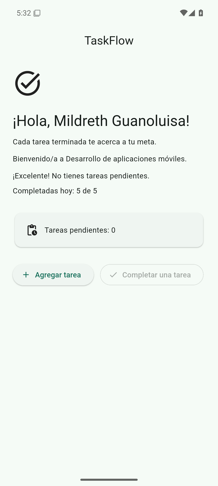
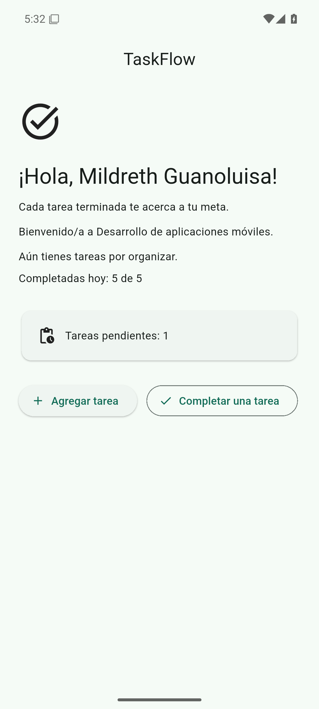

# TaskFlow

Aplicación de tareas del curso **Desarrollo de aplicaciones móviles**. Esta entrega es la sesión 2: la bienvenida pasa a ser un panel con estado, todo en `lib/main.dart`. La guía de la sesión se conserva en [LEEME.md](LEEME.md). La procedencia de las capturas está en [EVIDENCIAS.md](EVIDENCIAS.md).

**Estudiante:** Mildreth Guanoluisa

## Objetivo

Mostrar cuántas tareas quedan pendientes y cuántas se completaron hoy, y actualizar esos números en la misma pantalla. `WelcomeScreen` es un `StatefulWidget`. Los contadores viven en `_WelcomeScreenState` y cada acción redibuja la interfaz con `setState`.

Al abrir hay 3 tareas pendientes y 0 completadas. La meta del día es 5 (`dailyGoal`).

## Comportamiento

- **Agregar tarea** llama a `_addTask`. Dentro de `setState` suma 1 a `pendingTasks`.
- **Completar una tarea** llama a `_completeTask`. Si `pendingTasks` es 0, la función regresa sin modificar el estado. Si hay pendientes, resta 1 y, solo cuando `completedTasks` es menor que 5, suma 1 a las completadas de hoy.
- Las pendientes no bajan de 0. El botón queda deshabilitado (`onPressed: null`) cuando el contador está en cero, y `_completeTask` tampoco decrementa en ese caso.
- **Completadas hoy** no pasa de 5. Si la meta ya está llena y se agrega otra tarea, completarla baja las pendientes y deja el contador del día en 5.
- Con 0 pendientes el texto es `¡Excelente! No tienes tareas pendientes.` Con cualquier otro valor es `Aún tienes tareas por organizar.`
- El saludo usa el nombre `Mildreth Guanoluisa`. Se mantienen el mensaje `Cada tarea terminada te acerca a tu meta.`, el ícono `Icons.task_alt` y la paleta verde `Color(0xFF1F6F5B)` con Material 3.

## Requisitos

Declarados en `pubspec.yaml` (versión de la app `1.0.0+1`, `publish_to: none`):

| Requisito | Versión en `pubspec.yaml` | En `pubspec.lock` |
| --- | --- | --- |
| Dart SDK | `^3.13.7` | `>=3.13.7 <4.0.0` |
| Flutter | SDK | `>=3.18.0-18.0.pre.54` |
| `cupertino_icons` | `^1.0.8` | `1.0.9` |
| `flutter_test` | SDK (desarrollo) | SDK |
| `flutter_lints` | `^6.0.0` | `6.0.0` |

Hace falta el SDK de Flutter, con un Dart que cumpla `^3.13.7`. Las capturas se tomaron con Flutter 3.47.9. Ese dato y el emulador están en [EVIDENCIAS.md](EVIDENCIAS.md).

## Ejecutar

```bash
flutter pub get
flutter run
```

`flutter pub get` descarga las dependencias del `pubspec.yaml`. `flutter run` abre la app en el dispositivo o emulador que Flutter tenga conectado. La interfaz está en `lib/main.dart`.

## Comprobar

Hay una prueba de widgets en `test/widget_test.dart`: `el panel agrega, completa y respeta la meta de hoy`. Arranca en 3 pendientes y 0 de 5, pulsa **Agregar tarea** dos veces (queda en 5), completa cinco veces (queda en 0 y 5 de 5, con **Completar una tarea** deshabilitado) y comprueba que otra tarea nueva no sube la meta por encima de 5.

La guía de la sesión indica estos comandos:

```bash
dart format lib
flutter analyze
flutter test
```

`flutter analyze` usa `analysis_options.yaml`, que incluye `package:flutter_lints/flutter.yaml`.

## Estructura

```text
lib/main.dart                 Pantalla y estado de la sesión 2
test/widget_test.dart         Prueba de widgets del panel
pubspec.yaml                  Nombre, SDK y dependencias
pubspec.lock                  Versiones resueltas
analysis_options.yaml         Reglas del analizador
LEEME.md                      Guía original de la sesión 2
EVIDENCIAS.md                 Procedencia de las capturas
docs/evidencias/              PNG del emulador de esta sesión
android/                      Proyecto Android (com.example.taskflow)
ios/ linux/ macos/ web/ windows/   Proyectos de plataforma de Flutter
```

## Capturas

Emulador Android 15 (API 35), AVD `taskflow_api35`. Son capturas reales de ese emulador remoto, no de un teléfono físico. El código de la app es el de `main` en `4ab8ca32c47b9f3623d21476ee71590733c643f8`.

Pendientes en 0, meta diaria en 5 de 5 y **Completar una tarea** deshabilitado:



Una pendiente otra vez. La meta sigue en 5 de 5 y **Completar una tarea** vuelve a estar activo:


